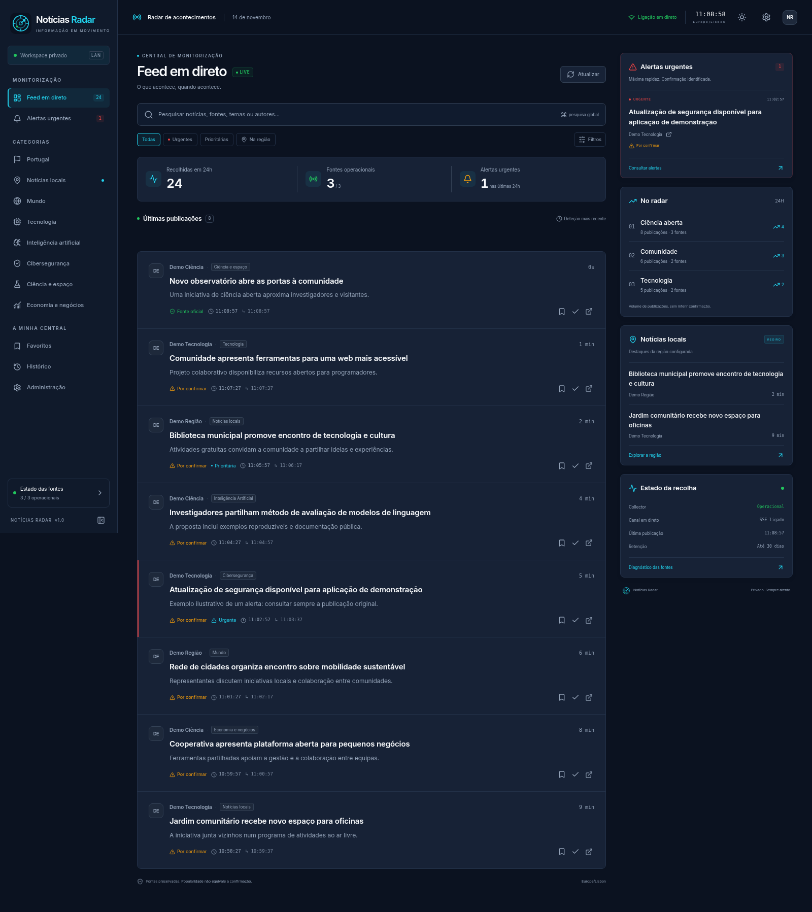
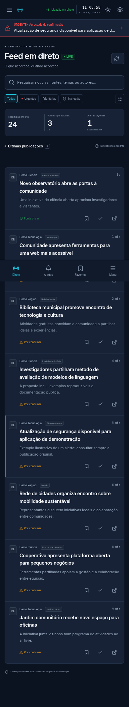

# News Radar

A self-hosted news dashboard for following feeds, topics and selected social accounts in one place. Built with React, Vite, Fastify and PostgreSQL, with a Portuguese-first interface and optional local translation into European Portuguese.

[Português (Portugal)](README.pt-PT.md) · [Documentation](docs/en/README.md) · [Contributing](CONTRIBUTING.md) · [Security](SECURITY.md)



*Screenshots show the actual interface with illustrative demo content. Live indicators, story totals and source counts are illustrative, not evidence of tested collection or source availability. They do not represent a live news service or publisher endorsement.*

## What it does

- Combines RSS/Atom feeds, Hacker News and opt-in Bluesky monitoring.
- Filters stories by source, category, search and priority; supports favourites and light/dark themes.
- Receives live updates and provides an administration area for sources, accounts and classification rules.
- Optionally translates titles and summaries locally into European Portuguese, preserving access to originals.
- Runs as a Docker Compose stack or a native Debian 13/LXC installation.

The documentation is available in English and Portuguese. The application interface is currently Portuguese-first; English documentation does not imply a translated English UI.

## Start with Docker Compose

You need Git, Node.js 24 or newer for the environment helper, and Docker Engine with the Compose plugin (version 2.20 or newer). Clone the upstream repository to start:

```sh
git clone https://github.com/Coretrail/news-radar.git news-radar
cd news-radar
node scripts/init-env.mjs
docker compose up -d --build --wait --wait-timeout 180
```

Once the owner enables GitHub's **Template repository** setting, you can also choose **Use this template** and clone your own repository URL instead.

The helper creates `.env` with independently generated passwords for the PostgreSQL application role and database administrator and never overwrites an existing file. Website administrator credentials are chosen later during setup. Review `.env` before starting, particularly source selection and network access. The startup command waits up to 180 seconds for the services to become ready; the one-shot `init` job is expected to exit successfully. If startup fails, inspect `docker compose ps` and `docker compose logs --tail=100 init api collector web`. Open **http://localhost:8080** after startup succeeds. The published port binds to `127.0.0.1` by default. An empty dashboard can be normal while collection starts, when sources are disabled or if upstream providers are unavailable.

To create your administrator account:

```sh
docker compose exec api node build/admin-cli.js
```

Open the one-time setup URL locally within 15 minutes. It contains a secret: do not share it, attach it to an issue, or include it in screenshots. If you use an SSH tunnel or another hostname, configure `APP_URL` to the address you actually open.

The default `SEED_SOURCES=minimal` enables only Hacker News and BBC World. `none` creates no sources; `all` adds an opt-in catalogue whose additional sources start disabled. Review each provider's terms before collecting or displaying content. Technical access to a feed or API does **not** grant a redistribution licence.

See the [complete Docker guide](docs/en/docker.md), [native Debian 13/LXC guide](docs/en/native-install.md), [configuration reference](docs/en/configuration.md) and [source policy](docs/en/sources.md).

## Deployment model

This template serves an unauthenticated reading dashboard and an authenticated administration area. Start with a trusted local environment. Publishing the source code does not require publishing your installation. Internet exposure requires an operator-managed TLS reverse proxy, carefully configured network access and an assessment of whether the reader's content may be public.

```text
Browser → web (nginx) → api (Fastify) → PostgreSQL
                           ↑               ↑
                       collector ──────────┘
                       translation (optional)
```

Docker Compose starts `db`, a one-shot `init` job, `api`, `collector` and `web`. Translation is a separate opt-in profile; model weights are not bundled with the repository or default application image.

<details>
<summary>Mobile preview</summary>



</details>

## Development and reuse

Read [development and checks](docs/en/development.md) before connecting a development instance to a database. Use a fresh database; integration tests use `newsradar_test`. Never run test or seed commands against an existing production deployment.

Application code is available under the [MIT licence](LICENSE). Dependencies, fonts and optional model weights retain their own licences; see [third-party notices](THIRD_PARTY_NOTICES.md). Publisher articles, images, feed contents and social posts are not relicensed by this project.

Maintainers preparing publication should follow the [publication review and validation scope](docs/en/release.md).

This repository is a clean public template. Supply your own configuration, sources, deployment settings and secrets. Do not copy operational databases, logs, backups, `.env` files or private repository history into a public fork.
