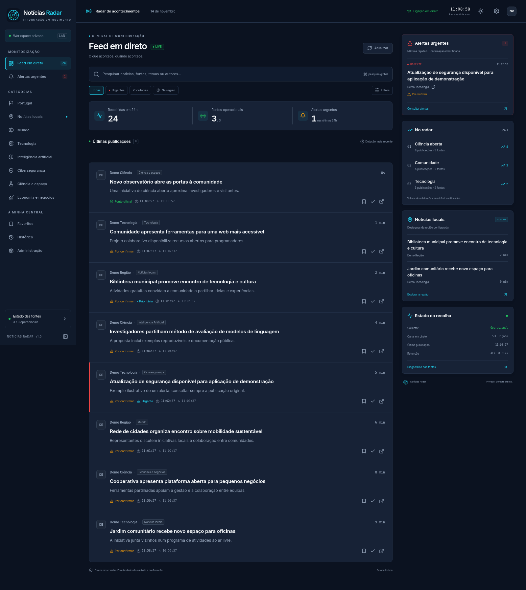
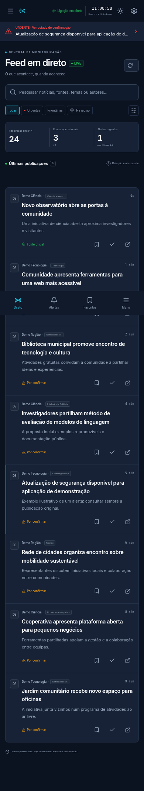

# News Radar

Um painel de notícias para alojamento próprio, que reúne feeds, temas e contas sociais selecionadas. Desenvolvido com React, Vite, Fastify e PostgreSQL, com interface em português e tradução local opcional para português europeu.

[English](README.md) · [Documentação](docs/pt/README.md) · [Contribuir](CONTRIBUTING.md) · [Segurança](SECURITY.md)



*As capturas mostram a interface real com conteúdo de demonstração ilustrativo. Os indicadores em direto, totais de notícias e contagens de fontes são ilustrativos, não comprovam testes de recolha nem a disponibilidade das fontes. Não representam um serviço de notícias em direto nem o apoio dos editores.*

## Funcionalidades

- Agrega feeds RSS/Atom, Hacker News e monitorização opcional do Bluesky.
- Filtra por fonte, categoria, pesquisa e prioridade; inclui favoritos e temas claro/escuro.
- Recebe atualizações em direto e permite gerir fontes, contas e regras de classificação na administração.
- Traduz opcionalmente títulos e resumos no próprio servidor para português europeu, mantendo o acesso aos originais.
- Funciona com Docker Compose ou numa instalação nativa em Debian 13/LXC.

A documentação existe em inglês e português. A interface da aplicação é atualmente orientada para português; a documentação inglesa não significa que exista uma interface traduzida para inglês.

## Começar com Docker Compose

Precisa de Git, Node.js 24 ou superior para o utilitário de configuração e Docker Engine com o plugin Compose (versão 2.20 ou superior). Para começar, clone o repositório original:

```sh
git clone https://github.com/Coretrail/news-radar.git news-radar
cd news-radar
node scripts/init-env.mjs
docker compose up -d --build --wait --wait-timeout 180
```

Depois de o proprietário ativar a opção **Template repository** do GitHub, também pode escolher **Use this template** e clonar o endereço do seu próprio repositório.

O utilitário cria `.env` com palavras-passe aleatórias independentes para o utilizador PostgreSQL da aplicação e para o administrador da base de dados e nunca substitui um ficheiro existente. As credenciais de administração do painel são escolhidas mais tarde durante a configuração. Reveja `.env` antes de iniciar, sobretudo a seleção de fontes e o acesso de rede. O comando de arranque espera até 180 segundos pelos serviços; é normal a tarefa `init` de execução única terminar com sucesso. Se o arranque falhar, consulte `docker compose ps` e `docker compose logs --tail=100 init api collector web`. Abra **http://localhost:8080** quando o arranque terminar com sucesso. A porta publicada fica associada a `127.0.0.1` por predefinição. É normal o painel estar vazio enquanto a recolha começa, com fontes desativadas ou se os fornecedores estiverem indisponíveis.

Para criar a conta de administração:

```sh
docker compose exec api node build/admin-cli.js
```

Abra o endereço de configuração de utilização única no prazo de 15 minutos. O endereço contém um segredo: não o partilhe, não o anexe a issues nem o inclua em capturas. Se usar um túnel SSH ou outro nome de servidor, configure `APP_URL` com o endereço que vai abrir.

A predefinição `SEED_SOURCES=minimal` ativa apenas Hacker News e BBC World. `none` não cria fontes; `all` acrescenta um catálogo opcional cujas fontes adicionais ficam desativadas. Reveja as condições de cada fornecedor antes de recolher ou apresentar conteúdo. O acesso técnico a um feed ou API **não** concede uma licença de redistribuição.

Consulte o [guia Docker completo](docs/pt/docker.md), a [instalação nativa Debian 13/LXC](docs/pt/native-install.md), a [configuração](docs/pt/configuration.md) e a [política de fontes](docs/pt/sources.md).

## Modelo de instalação

Este template disponibiliza um painel de leitura sem autenticação e uma área administrativa autenticada. Comece num ambiente local de confiança. Publicar o código não exige publicar a instalação. O acesso pela Internet exige um proxy inverso com TLS, acesso de rede configurado pelo operador e uma avaliação dos conteúdos que podem ficar públicos.

```text
Navegador → web (nginx) → api (Fastify) → PostgreSQL
                             ↑               ↑
                         collector ──────────┘
                         translation (opcional)
```

O Docker Compose inicia `db`, uma tarefa `init` de execução única, `api`, `collector` e `web`. A tradução é um perfil opcional separado; os modelos não são incluídos no repositório nem na imagem predefinida da aplicação.

<details>
<summary>Pré-visualização em telemóvel</summary>



</details>

## Desenvolvimento e reutilização

Leia [desenvolvimento e verificações](docs/pt/development.md) antes de ligar uma instância de desenvolvimento a uma base de dados. Use uma base de dados nova; os testes de integração usam `newsradar_test`. Nunca execute testes ou comandos de dados iniciais numa instalação de produção existente.

O código da aplicação usa a [licença MIT](LICENSE). Dependências, tipos de letra e modelos opcionais mantêm as suas próprias licenças; consulte os [avisos de terceiros](THIRD_PARTY_NOTICES.md). Artigos, imagens, conteúdos dos feeds e publicações sociais não são relicenciados por este projeto.

Os responsáveis pela publicação devem seguir a [revisão de publicação e âmbito da validação](docs/pt/release.md).

Este repositório é um template público limpo. Forneça a sua configuração, fontes, opções de instalação e segredos. Não copie bases de dados operacionais, registos, cópias de segurança, ficheiros `.env` ou histórico privado para um fork público.
